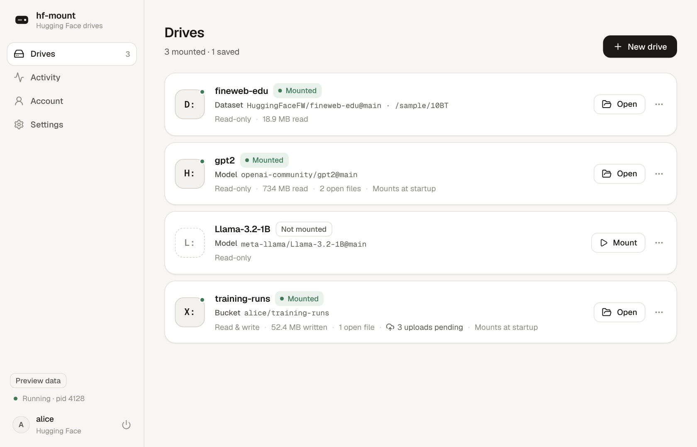
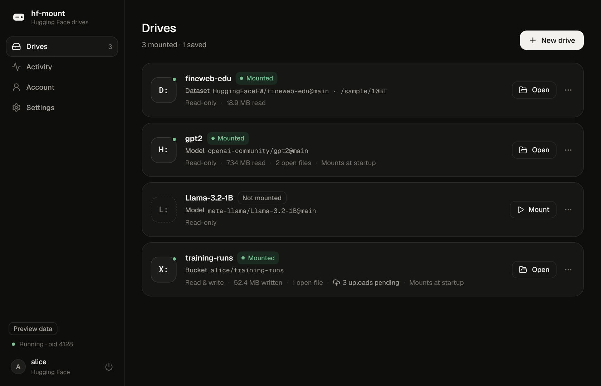
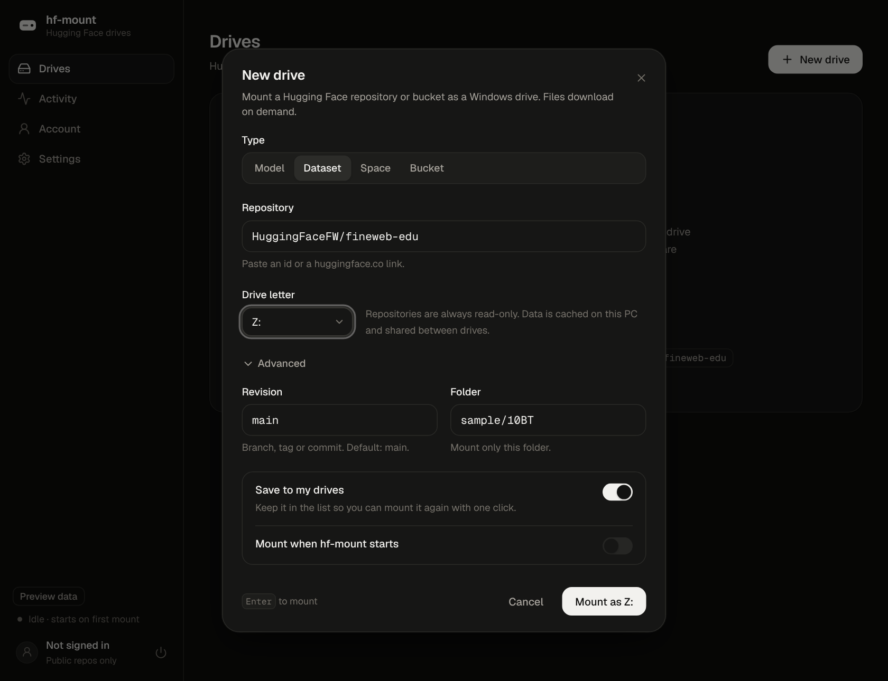
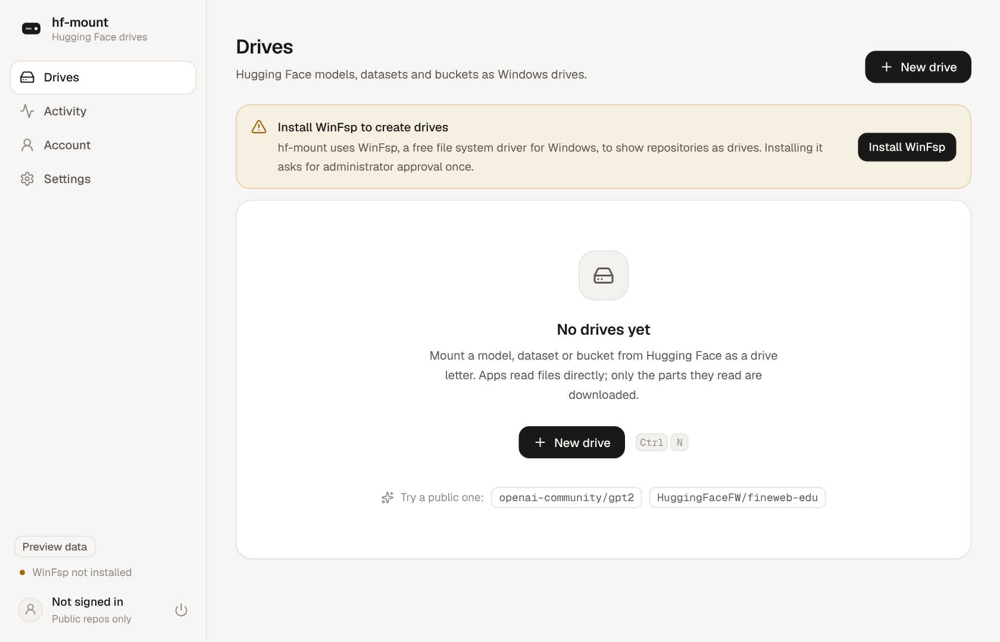
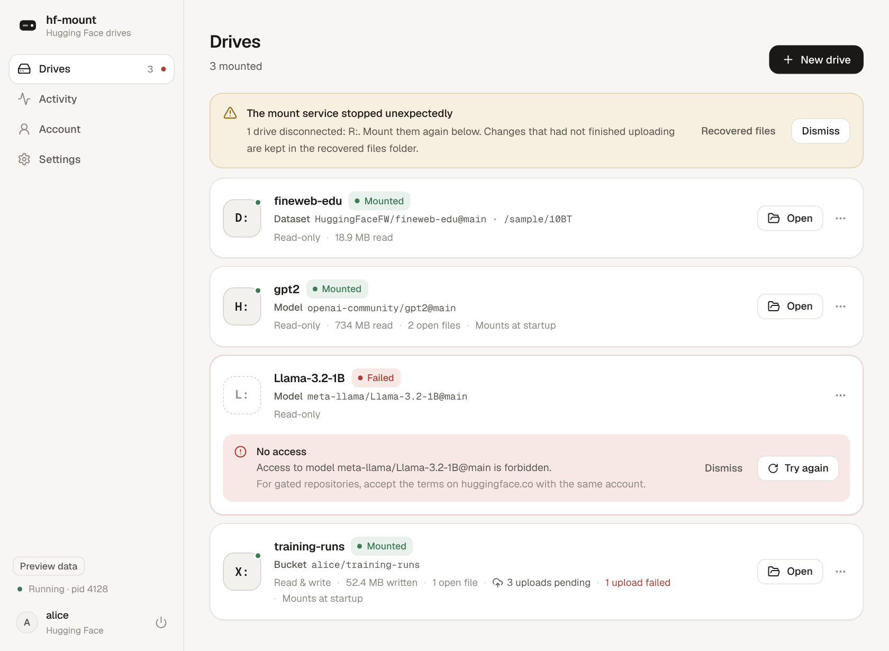
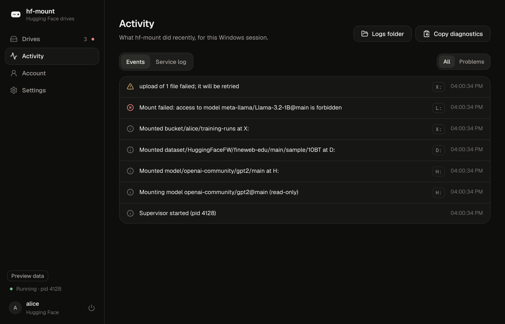
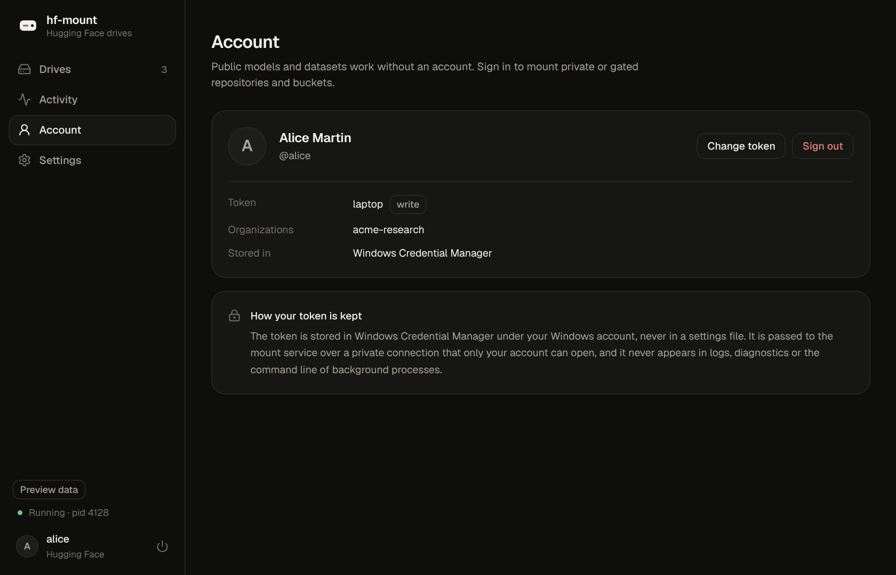
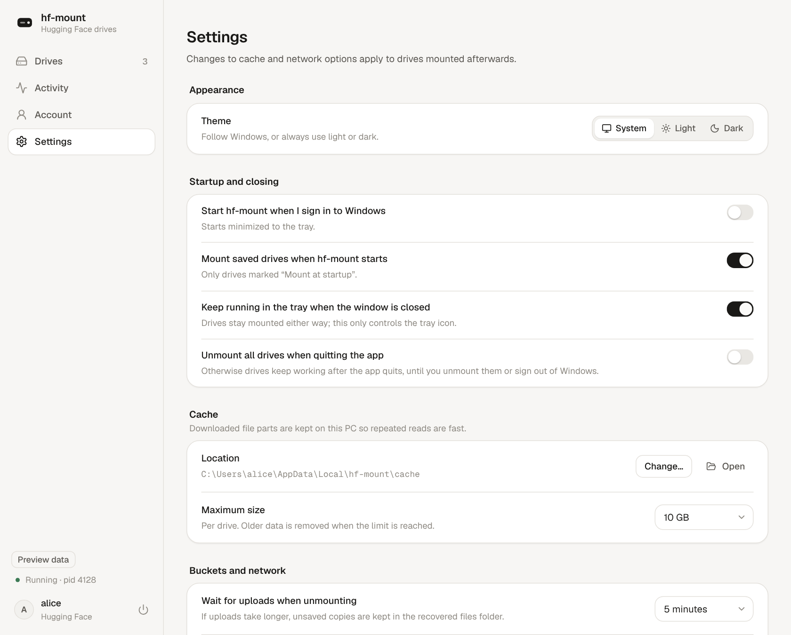

# hf-mount on Windows

User guide for the Windows edition: the desktop app, how drives behave, where
data lives, known limitations and what has been verified. Installation and the
command line are summarised in the README's "Windows" section; the design is
in [windows-architecture.md](windows-architecture.md).

## Desktop app

The desktop app ("hf-mount Desktop") is a window plus a tray icon. It never
hosts drives itself: it asks the same background supervisor that
`hf-mount.exe` uses, so drives mounted from the command line appear in the app
and vice versa, and drives keep working after the window or the app closes.

| Drives (light) | Drives (dark) |
| --- | --- |
|  |  |

| New drive (a pasted Hub link fills in type, revision and folder) | First run without WinFsp |
| --- | --- |
|  |  |

| Errors and a lost session | Activity |
| --- | --- |
|  |  |

| Account | Settings |
| --- | --- |
|  |  |

*The screenshots show the UI rendered in a browser with built-in sample data
(note the "Preview data" badge); they are not screenshots of real mounts.*

* **Drives**: every drive of your Windows session (from the app, the CLI or a
  `--foreground` console) and your saved drives. Open a drive in Explorer, copy
  its path, view it on Hugging Face, retry failed uploads, mount at startup,
  unmount. Failed mounts show the reason and what to do ("Sign-in needed",
  "Drive letter is in use", ...) with *Try again*.
* **New drive** (`Ctrl+N`): choose Model, Dataset, Space or Bucket, type an id
  or paste a `huggingface.co` link, pick a free letter (the highest free
  letter is suggested), optionally a revision and a folder. Buckets can be
  mounted read-write or read-only. *Save to my drives* keeps it in the list;
  *Mount when hf-mount starts* reconnects it at startup.
* **Activity**: mount, unmount, upload and error events, the service log
  (redacted), *Copy diagnostics* (a redacted report for bug reports) and the
  logs folder.
* **Account**: sign in with an access token (checked with the Hub, stored in
  Windows Credential Manager), see the account and token role, change the
  token, sign out.
* **Settings**: theme (System/Light/Dark), start at sign-in (minimized to the
  tray), reconnect saved drives, close-to-tray, unmount on quit, cache folder
  and size, upload wait on unmount, metadata refresh interval, Hub address,
  the CLI path, and the WinFsp notice.
* **Tray**: Open, New drive, Hide window, Unmount all drives, *Quit app
  (drives stay mounted)* and *Quit and unmount all drives* are separate
  entries. The tooltip lists mounted drives. The sidebar's power menu offers
  the same choices.
* Keyboard: `Ctrl+N` new drive, `Ctrl+1`–`Ctrl+4` pages, arrow keys in
  segmented controls, `Esc` closes dialogs; every control is reachable with
  `Tab` and has a visible focus ring. Animations are disabled when Windows
  "Animation effects" (reduced motion) is off.

## How drives behave

* **Lazy reads.** Listing a folder or opening a file does not download it;
  reads fetch only the requested byte ranges, which are kept in an on-disk
  cache (`%LOCALAPPDATA%\hf-mount\cache`, 10 GB per source by default).
  Files larger than 4 GiB work.
* **Read-only repositories.** Model, dataset and Space repositories are always
  read-only; writes fail with "The media is write protected".
* **Buckets.** Read-write unless mounted read-only. Closing a file returns
  once its data is saved locally; it is uploaded in the background a moment
  later. `hf-mount status` and the app show pending and failed uploads. Unmount
  waits for uploads (5 minutes by default) and reports files that could not be
  uploaded; copies are kept in `%LOCALAPPDATA%\hf-mount\recovered`.
* **Names.** The drive is case-sensitive and case-preserving, so `README.md`
  and `readme.md` stay two different files. On read-only drives a path typed
  in a different case still opens the file when exactly one file matches.
  Remote names Windows cannot represent (`< > : " | ? *`, trailing dots or
  spaces, `CON`, `NUL`, `COM1`, ...) are hidden and logged.
* **Remote changes** are picked up by polling (every 30 s by default) and when
  cached metadata expires (10 s). Explorer windows already open on the drive
  are not notified and may need a refresh (F5).
* **Who sees a drive.** Drives belong to your Windows user and sign-in
  session. Programs running *as administrator* run in a different session and
  do not see them (and drives mounted from an elevated console are invisible
  to Explorer); the CLI and the app warn about this.

## Troubleshooting

| Symptom | What to do |
| --- | --- |
| "WinFsp is not installed" (exit code 3) | Install it from the app, with `install-winfsp.ps1`, `winget install WinFsp.WinFsp`, or from <https://winfsp.dev/rel/>. No reboot is normally needed. |
| "Drive letter is in use" (exit 6) | Pick another letter; `hf-mount drives` lists free ones. |
| "Sign-in needed" / "No access" (exit 4) | Private or gated repositories and buckets need a token with access (`hf-mount auth login` or the Account page). For gated models, accept the terms on huggingface.co first. |
| Drive not visible in Explorer | Check that neither the console nor the app runs as administrator. |
| Unmount says files are open (exit 10) | Close the programs using the drive, or `hf-mount stop X: --force`. |
| Anything else | `hf-mount doctor`, the Activity page, logs in `%LOCALAPPDATA%\hf-mount\logs`. |

## Files and uninstalling

| Path | Content |
| --- | --- |
| `%LOCALAPPDATA%\hf-mount Desktop\` | The desktop app and `hf-mount.exe` (per-user installer). |
| `%LOCALAPPDATA%\hf-mount\` | Settings, saved drives, logs, cache, recovered files (shared by the app and the CLI). |
| Windows Credential Manager, `hf-mount:huggingface.co` | The stored token. |

Uninstalling the app unmounts your drives (waiting for uploads) and removes
the program files. It keeps `%LOCALAPPDATA%\hf-mount`, the stored token and
WinFsp, which other software may use; remove them manually if you want.

## Known limitations

* **Windows x64 only.** No ARM64 build yet. Targets Windows 10 and 11.
* **Not code-signed.** SmartScreen may warn; verify files with `SHA256SUMS.txt`.
* **No change notifications** to Explorer for remote changes (see above).
* **Symbolic links** in buckets are not shown on Windows. File attributes
  (hidden, system), alternate data streams, extended attributes, ACL changes
  and hard links are not supported; file times set by programs are kept only
  while the drive stays mounted (the Hub records its own times).
* **Bucket writes are not transactional.** "Save via temporary file and
  rename" works but is not atomic towards other writers; there is no
  cross-machine locking. Data is safe in the local staging area once a file is
  closed, but only on the Hub after the background upload; if the supervisor
  is killed (Task Manager, crash) before that, the staged files stay in the
  cache directory and the next start reports the lost session.
* **Overlay mode** (`--overlay`) and NFS/FUSE options are not available on
  Windows.
* **Drives do not survive sign-out or reboot**; saved drives marked "Mount
  when hf-mount starts" are reconnected when the app starts (it can start at
  sign-in).
* The MSI installer does not offer WinFsp during installation; the app offers
  the bundled installer on first start instead.

## Verification status

What has been checked, and how. "CI" means the `Windows` workflow on
GitHub-hosted runners (`windows-2025`, `ubuntu-24.04`) on this pull request.

| Area | Verified by | Status |
| --- | --- | --- |
| Engine builds for `x86_64-pc-windows-msvc`; Windows unit tests | CI (`cargo test --lib`) | see the pull request |
| Real WinFsp drive letters against a deterministic mock Hub: listing, exact bytes, random/overlapping/>4 GiB reads, concurrent handles, Unicode and hidden names, case rules, error codes, read-only refusal, bucket write + commit, unmount/re-mount, letter collisions | CI (`windows::mount_tests`, WinFsp 2.1 installed from the pinned MSI) | see the pull request |
| Live public repository (`openai-community/gpt2`): listing, bytes and ranges match the Hub, lazy cache growth, writes refused, status, duplicate letter, stop, re-mount | CI (`scripts/windows/smoke-test.ps1`) | see the pull request |
| CLI argument handling and exit codes | CI | see the pull request |
| Installer: silent install, bundled WinFsp MSI integrity, CLI runs, app starts, silent uninstall keeps user data | CI (`scripts/windows/desktop-install-test.ps1`) | see the pull request |
| Desktop UI: typecheck, lint, component tests (navigation, keyboard, theme, URL parsing, validation, errors) | CI (`frontend` job) | see the pull request |
| Private repositories and bucket writes against the real Hub | Opt-in CI job (`authenticated`, `scripts/windows/authenticated-test.ps1`) that runs only when the repository owner sets the `HF_TOKEN` secret and `HF_MOUNT_TEST_BUCKET` / `HF_MOUNT_TEST_PRIVATE_REPO` variables | **not verified** in this pull request (not configured) |
| The desktop app clicked through on a real Windows desktop with real mounts | Not possible on CI runners | **not verified** (UI verified in a browser against sample data; app start verified in CI) |
| Interactive WinFsp installation from the app or installer (UAC) | Needs an interactive session | **not verified** |
| Windows 10, ARM64, non-English Windows | — | **not verified** |
